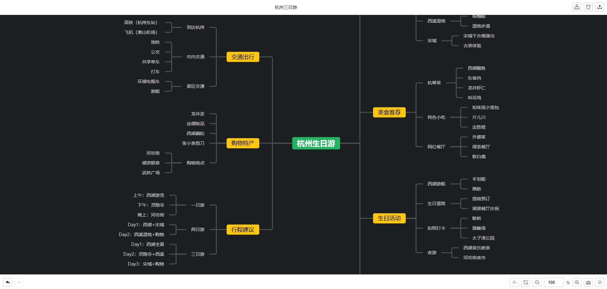

# simple-mind-map-creator

一个用于生成思维导图的技能。

## 这个SKILL能做什么？

当你需要生成一个思维导图时，可以使用这个技能。比如：

```text
生成一个主题为“杭州三日游”的思维导图。
```

```text
分析当前项目，然后生成一个思维导图。
```

```text
把这段内容转换成思维导图。内容：xxxx。
```

可以指定想要使用的结构：

```text
生成一个主题为“杭州三日游”的思维导图。使用鱼骨图。
```

所有可用的结构如下：

```text
逻辑结构图、逻辑结构图（左）、思维导图、目录组织图、组织结构图、时间轴、上下交替型时间轴、竖向时间轴、鱼骨图
```

可以指定想要使用的主题类型：

```text
生成一个主题为“杭州三日游”的思维导图。使用暗色主题。

生成一个主题为“杭州三日游”的思维导图。使用亮色主题。
```

AI最终会输出一个HTML文件，你可以直接在浏览器上打开查看生成的思维导图，也可以直接进行编辑，功能列表：

- 画布操作：拖拽、放大缩小；
- 节点操作：框选节点、添加/删除节点、编辑节点文本、复制粘贴、前进后退；
- 支持切换结构；
- 支持切换主题；
- 支持导出为：图片、SVG、PDF、Markdown、XMind、Txt、JSON文件；
- 支持切换只读、编辑模式；

**特别提醒**：思维导图的编辑是无法持久化的，意味着你关闭HTML文件后，编辑的内容会丢失，会回到最初AI生成的内容，所以建议编辑完后立即导出为其他格式文件。

为了方便分享，部分操作状态会添加到URL中，比如：修改标题名称、切换的结构、主题、只读模式，进行这几个操作你会发现浏览器上的url会发生变化，当你把带这些状态的URL分享给其他人，他们点开后可以恢复到和你一样的状态。

## 安装

### 电脑上安装了GIT软件

直接把这段话发给你的 AI 助手（Claude Code / Cursor / Copilot / 其他支持 Skill 的工具）：

```text
帮我安装 simple-mind-map-creator 这个 skill。请执行以下步骤：

1. 确保 ~/.claude/skills/ 目录存在（不存在就创建）
2. 执行 git clone https://github.com/wanglin2/simple-mind-map-creator.git ~/.claude/skills/simple-mind-map-creator
3. 告诉我装好了，之后我说"生成思维导图"就会触发这个 skill
```

### 电脑上没有安装GIT软件

直接下载当前仓库的代码为ZIP格式文件，然后把下载下来的ZIP解压缩放到 ~/.claude/skills/ 目录下。

如果使用了其他工具，比如WorkBuddy，请按照这些工具的安装指引进行操作。

# 原理

本SKILL中思维导图编辑能力来源于项目[mind-map](https://github.com/wanglin2/mind-map)。

推荐使用该项目的客户端版本[思绪思维导图](https://sxmind.cn/)，一个非常强大的思维导图软件。

# 截图



# License

MIT License